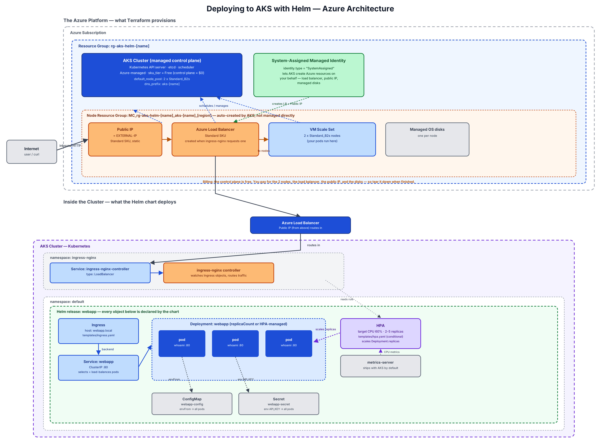

# Deploying to AKS with Helm

A managed Kubernetes cluster on Azure (AKS) provisioned with Terraform, running a real web app packaged as a Helm chart — Deployment, Service, Ingress, config, secret, health probes, resource limits, and an autoscaler, all declared as one versioned, parameterized unit you can install, upgrade, and roll back with a single command.


## 🎥 Demo Video
[Watch me build this lab end-to-end →](your-loom-link-here)

## Overview

| Field | Value |
|---|---|
| Difficulty | Intermediate |
| Time to complete | 4 to 5 hours |
| IaC / packaging tools | Terraform v1.5+ (azurerm provider ~> 4.0), Helm 3 |
| Platform note | `kubectl` and Helm both run natively on Windows — no WSL required for this lab |
| Career relevance | Cloud Engineer, DevOps Engineer, Platform Engineer, Kubernetes Administrator |

**How this fits the series:** an earlier lab provisioned infrastructure with Terraform; another configured servers with Ansible. This lab moves up the stack to containers. Terraform still provisions the platform — here, the AKS cluster — but the unit of deployment is no longer a server. It's an application packaged as a Helm chart.

## The Business Problem This Lab Solves

An app runs perfectly on one engineer's laptop. Then it has to run in dev, staging, and production — and each environment ends up subtly different. Someone sets two replicas here and four there, the database URL is hand-edited in one place, a teammate tweaks a YAML file directly in production to fix a fire and never writes it down. Now the environments have drifted, nobody can reproduce a deployment, and a rollback means frantically remembering what the previous state was.

Helm fixes this. It packages an application and every Kubernetes object it needs into a single versioned chart, with the per-environment differences pulled out into a values file. Every environment deploys from the same chart; only the values change. Upgrades and rollbacks happen to the whole release at once, as one tracked unit.

**Lead with the outcome in an interview:** "I packaged our app so it deploys identically to every environment from one versioned chart and one values file, and I can upgrade or roll back the entire release in a single command." Kubernetes, AKS, Deployments, and Services are the supporting details you bring out when they ask how.

**The sentence that signals real understanding of Helm:** "The chart is the contract — it declares every object the app needs, the values file is the only thing that changes between environments, and the release history lets me roll back to any previous revision instantly."

## Architecture Overview



There are two halves to this system, and they're owned by two different tools:

**The Azure platform (Terraform's job).** Terraform creates a resource group holding the AKS cluster, whose control plane Azure manages for free. The moment the cluster comes up, Azure also creates a second, auto-managed node resource group (the `MC_...` one) that holds the actual worker VMs. Later, when the ingress controller asks for a `LoadBalancer`, Azure drops a load balancer and a public IP into that same group. You manage the first resource group directly; the second is managed for you — don't delete or modify resources inside it by hand.

**Inside the cluster (Helm's job).** Everything inside the Helm-release boundary is declared by the chart. Traffic enters through the ingress controller's `LoadBalancer` Service, is routed by the Ingress rule for `webapp.local` to the `webapp` Service, which load-balances across the Deployment's pods. The Horizontal Pod Autoscaler (HPA) scales those pods on CPU, using metrics supplied by `metrics-server`, while the ConfigMap and Secret feed configuration into the running pods. One chart, one release, every object accounted for.

| Component | Role |
|---|---|
| Resource Group (`rg-aks-helm-[yourname]`) | Holds the AKS cluster resource that Terraform manages directly |
| AKS Cluster (Free tier control plane) | Azure-managed Kubernetes API server, etcd, and scheduler — no charge for the control plane itself |
| Node Resource Group (`MC_...`, auto-created) | Holds the VM Scale Set (2x Standard_B2s), the load balancer, the public IP, and the managed disks — this is what you actually pay for |
| System-Assigned Managed Identity | Lets AKS create Azure resources on your behalf (the load balancer and public IP the ingress controller requests) |
| ingress-nginx (installed via Helm) | The ingress controller and the cloud load balancer it provisions — the front door for all HTTP traffic |
| Helm release `webapp` | The application: Ingress, Service, Deployment, ConfigMap, Secret, and HPA, all declared by one chart |

## The Deployment Strategy — Terraform Provisions, Helm Deploys

The two tools own different layers. Terraform provisions the platform and records it in state; its output hands you the `az aks get-credentials` command, which writes your kubeconfig. That kubeconfig is the handoff: Helm then uses it to deploy the application as a release. Infrastructure and application stay cleanly separated — which is exactly how you want to be able to describe it in an interview.

Notably, only the `azurerm` provider is needed in Terraform here — `az aks get-credentials` wires up `kubectl` after the cluster exists, so Terraform never has to handle the kubeconfig itself, which keeps cluster credentials out of the Terraform state file entirely.

## Skills Demonstrated

| Skill | Real-world application |
|---|---|
| Provisioning a managed Kubernetes cluster with Terraform | The standard pattern for getting a cluster into existence reproducibly, rather than clicking through the portal |
| Packaging an application as a Helm chart from scratch | Understanding what `helm create` scaffolds by building the templates by hand — "I used Helm" vs. "I understand Helm" |
| Named template helpers (`_helpers.tpl`) for consistent naming and labels | The standard Helm pattern that keeps every object in a chart named and labeled consistently from one defined rule |
| `toYaml` / `nindent` for passing structured values into manifests | Lets a values file drive arbitrary YAML blocks (resources, config) without hand-writing each line in every template |
| Liveness and readiness probes | The difference between "restart this pod" and "stop sending it traffic" — a distinction every production Kubernetes workload depends on |
| The `checksum/config` annotation pattern | A professional touch that rolls pods automatically when a ConfigMap changes, instead of leaving stale config running until an unrelated deploy |
| Horizontal Pod Autoscaler driven by `metrics-server` | Automatic, CPU-based scaling that AKS supports out of the box with zero extra components |
| Helm release lifecycle: `upgrade --install`, `history`, `rollback` | A versioned, one-command undo stack — the single most compelling thing to demonstrate in an interview |
| Conditional resources (`{{- if .Values.x.enabled }}`) | The standard Helm pattern for toggling optional objects (Ingress, HPA) with one values flag instead of maintaining separate chart variants |

## What Gets Built

```
aks-helm-lab/
├── terraform/                        → provisions the cluster (Terraform's job)
│   ├── Resource Group
│   └── AKS Cluster (2x B2s nodes)     → managed Kubernetes; control plane is free
│
└── webapp-chart/                      → the application, packaged (Helm's job)
    ├── Chart.yaml                     → chart name, version, appVersion
    ├── values.yaml                    → the one file that changes per environment
    ├── .helmignore
    └── templates/
        ├── _helpers.tpl                → reusable name + label snippets
        ├── deployment.yaml             → pods, image, probes, resources, env
        ├── service.yaml                → stable in-cluster address
        ├── ingress.yaml                → external HTTP entry point (conditional)
        ├── configmap.yaml              → non-secret config
        ├── secret.yaml                 → the secret value
        ├── hpa.yaml                    → horizontal pod autoscaler (conditional)
        └── NOTES.txt                   → post-install instructions

Cluster add-on (installed via Helm):
  ingress-nginx                         → the ingress controller + cloud load balancer
```

## Prerequisites

Terraform and the Azure CLI (install as in an earlier Terraform-based lab if not already present, then log in). This lab adds two tools: `kubectl` (talks to the cluster) and `helm` (packages and deploys the app). Both run natively on macOS, Linux, and Windows — there's no WSL requirement here, unlike labs that depend on Ansible.

```bash
az login
az account set --subscription "Azure subscription 1"
az account show
```

**Install kubectl and Helm — Mac:**
```bash
brew install kubectl helm
kubectl version --client
helm version
```

**Install kubectl and Helm — Windows (PowerShell):**
```powershell
winget install -e --id Kubernetes.kubectl
winget install -e --id Helm.Helm
kubectl version --client
helm version
```
> If `kubectl` or `helm` is "not recognized" right after install on Windows, close and reopen PowerShell so the PATH refreshes. On any platform, `az aks install-cli` is a fallback that installs kubectl for you.

## Folder Setup
```bash
mkdir aks-helm-lab
cd aks-helm-lab
mkdir terraform
```
Create the Terraform files inside `terraform/`. The Helm chart is scaffolded with a single command in Part C, so don't create `webapp-chart` by hand yet.

## PART A — Provision AKS with Terraform

All files in this part go inside the `terraform/` folder.

### Step A1 — `variables.tf`
AKS bills you for the worker nodes, not the control plane (on the Free tier, the managed control plane is $0). The node pool is kept small and cheap, with size and count parameterized so you can scale later.
```hcl
variable "yourname" {
  description = "Your name, lowercase, no spaces. Makes resource names unique."
  type        = string
}

variable "location" {
  description = "Azure region to deploy into."
  type        = string
  default     = "East US"
}

variable "node_count" {
  description = "Number of worker nodes in the system pool."
  type        = number
  default     = 2
}

variable "vm_size" {
  description = "VM size for each node. B2s is small and cheap for a lab."
  type        = string
  default     = "Standard_B2s"
}

variable "tags" {
  type = map(string)
  default = {
    project     = "aks-helm"
    environment = "dev"
    managed_by  = "terraform"
  }
}
```

### Step A2 — `terraform.tfvars`
```hcl
yourname = "charles"
location = "East US"
```

### Step A3 — `main.tf`

**Providers.** Only the `azurerm` provider is needed here — `az aks get-credentials` will wire up `kubectl` after the cluster exists, so Terraform never has to handle the kubeconfig, which keeps cluster credentials out of your state file.
```hcl
terraform {
  required_providers {
    azurerm = {
      source  = "hashicorp/azurerm"
      version = "~> 4.0"
    }
  }
}

provider "azurerm" {
  features {}
}
```

**Resource group:**
```hcl
resource "azurerm_resource_group" "main" {
  name     = "rg-aks-helm-${var.yourname}"
  location = var.location
  tags     = var.tags
}
```

**The AKS cluster.** This is the whole cluster in one resource. `default_node_pool` is the pool of worker VMs your pods run on. `identity { type = "SystemAssigned" }` gives the cluster a managed identity so it can create cloud resources on your behalf — for example, the load balancer the ingress controller will ask for. `sku_tier = "Free"` keeps the managed control plane free; you pay only for the nodes above.
```hcl
resource "azurerm_kubernetes_cluster" "main" {
  name                = "aks-${var.yourname}"
  location            = azurerm_resource_group.main.location
  resource_group_name = azurerm_resource_group.main.name
  dns_prefix          = "aks-${var.yourname}"
  sku_tier            = "Free"

  default_node_pool {
    name       = "system"
    node_count = var.node_count
    vm_size    = var.vm_size
  }

  identity {
    type = "SystemAssigned"
  }

  tags = var.tags
}
```

### Step A4 — `outputs.tf`
The most useful output is the exact command to point `kubectl` at your new cluster — copy-paste it after `apply` and you're connected.
```hcl
output "resource_group_name" {
  value = azurerm_resource_group.main.name
}

output "cluster_name" {
  value = azurerm_kubernetes_cluster.main.name
}

output "get_credentials_command" {
  description = "Run this to point kubectl at the new cluster."
  value       = "az aks get-credentials --resource-group ${azurerm_resource_group.main.name} --name ${azurerm_kubernetes_cluster.main.name} --overwrite-existing"
}
```

### Step A5 — Deploy the cluster
From the `terraform/` folder, set the subscription for the `azurerm` 4.x provider first:
```bash
export ARM_SUBSCRIPTION_ID=$(az account show --query id -o tsv)
```
On Windows PowerShell, the equivalent is:
```powershell
$env:ARM_SUBSCRIPTION_ID = (az account show --query id -o tsv)
```
Then the standard cycle:
```bash
terraform init
terraform plan
terraform apply
```
Type `yes` when prompted. An AKS cluster takes about 5 to 7 minutes to provision.

### Step A6 — Connect kubectl to the cluster
Copy the `get_credentials_command` from the Terraform output and run it. Then confirm both nodes are present and `Ready`:
```bash
az aks get-credentials --resource-group rg-aks-helm-charles --name aks-charles --overwrite-existing
kubectl get nodes
```
You should see two nodes with `STATUS Ready`. If so, your control machine is now talking to the cluster.

## PART B — Install the Ingress Controller (your first Helm install)

Before your app can be reached from the internet, the cluster needs an ingress controller — the component that watches Ingress objects and actually routes traffic. We install the popular `ingress-nginx` controller, with Helm. This is itself a useful Helm skill: adding a chart repository and installing a third-party chart, with overrides passed via `--set`.
```bash
helm repo add ingress-nginx https://kubernetes.github.io/ingress-nginx
helm repo update

helm install ingress-nginx ingress-nginx/ingress-nginx \
  --namespace ingress-nginx --create-namespace \
  --set controller.service.type=LoadBalancer
```
Setting the controller service to `LoadBalancer` makes AKS provision a real Azure load balancer with a public IP. Watch for that IP to appear (it takes a minute or two):
```bash
kubectl get service ingress-nginx-controller -n ingress-nginx -w
```
When the `EXTERNAL-IP` column changes from `<pending>` to an actual address, press Ctrl+C and note that IP — it's the front door to everything you deploy next.

## PART C — Package the App as a Helm Chart

This is the heart of the project. In real life you'd start a chart with `helm create webapp-chart`, which scaffolds a working example. We create the files by hand instead, because writing each one — and understanding what every line does — is what turns "I used Helm" into "I understand Helm."

From the `aks-helm-lab/` folder, create the structure:
```bash
mkdir -p webapp-chart/templates
```

### Step C1 — `Chart.yaml`
`Chart.yaml` is the chart's identity card. Note the two version fields — they answer different questions. `version` is the version of the chart (the packaging); `appVersion` is the version of the application inside it. They move independently: you might fix a typo in a template (bump `version`) without changing the app at all.
```yaml
apiVersion: v2
name: webapp
description: A Helm chart that packages a stateless web app for Kubernetes
type: application
version: 0.1.0
appVersion: "1.0"
```

### Step C2 — `values.yaml`
This is the single most important file for the "deploys identically everywhere" story. Every value a different environment might need to change lives here, and nowhere else. The templates read from this file; to deploy to staging vs. production you change values, not templates. We deploy `traefik/whoami`, a tiny app that returns a page showing which pod served the request — perfect for watching a Service load-balance across replicas.
```yaml
replicaCount: 2

image:
  repository: traefik/whoami
  tag: "v1.10.2"
  pullPolicy: IfNotPresent

nameOverride: ""
fullnameOverride: ""

service:
  type: ClusterIP
  port: 80

ingress:
  enabled: true
  className: nginx
  host: webapp.local
  path: /
  pathType: Prefix

resources:
  requests:
    cpu: 50m
    memory: 64Mi
  limits:
    cpu: 200m
    memory: 128Mi

probes:
  path: /

config:
  WELCOME_MESSAGE: "Hello from Helm on AKS"

secret:
  apiKey: "change-this-please"

autoscaling:
  enabled: true
  minReplicas: 2
  maxReplicas: 5
  targetCPUUtilizationPercentage: 60
```

### Step C3 — `templates/_helpers.tpl`
Named templates are reusable snippets you define once and `include` everywhere — the equivalent of functions. Defining names and labels here means every object in the chart is named and labeled consistently, and you change the rule in one place. The `fullname` logic below is the standard Helm pattern: it avoids silly names like `webapp-webapp` when the release name already contains the chart name.
```
{{- define "webapp.name" -}}
{{- default .Chart.Name .Values.nameOverride | trunc 63 | trimSuffix "-" -}}
{{- end -}}

{{- define "webapp.fullname" -}}
{{- if .Values.fullnameOverride -}}
{{- .Values.fullnameOverride | trunc 63 | trimSuffix "-" -}}
{{- else -}}
{{- $name := default .Chart.Name .Values.nameOverride -}}
{{- if contains $name .Release.Name -}}
{{- .Release.Name | trunc 63 | trimSuffix "-" -}}
{{- else -}}
{{- printf "%s-%s" .Release.Name $name | trunc 63 | trimSuffix "-" -}}
{{- end -}}
{{- end -}}
{{- end -}}

{{- define "webapp.labels" -}}
app.kubernetes.io/name: {{ include "webapp.name" . }}
app.kubernetes.io/instance: {{ .Release.Name }}
app.kubernetes.io/managed-by: {{ .Release.Service }}
helm.sh/chart: {{ printf "%s-%s" .Chart.Name .Chart.Version }}
{{- end -}}

{{- define "webapp.selectorLabels" -}}
app.kubernetes.io/name: {{ include "webapp.name" . }}
app.kubernetes.io/instance: {{ .Release.Name }}
{{- end -}}
```

### Step C4 — `templates/deployment.yaml`
The Deployment is where the core concepts converge. Replicas come from values (unless the autoscaler owns them); the image is assembled from values; config is injected from a ConfigMap and the secret from a Secret; **liveness and readiness probes** tell Kubernetes when to restart a pod versus when to simply stop sending it traffic; and **resource requests and limits** drive both scheduling and protection against a runaway pod. The `checksum/config` annotation is a professional touch: it hashes the ConfigMap into the pod template, so changing config automatically rolls the pods — without it, a config change would sit unused until the next unrelated deploy.
```yaml
apiVersion: apps/v1
kind: Deployment
metadata:
  name: {{ include "webapp.fullname" . }}
  labels:
    {{- include "webapp.labels" . | nindent 4 }}
spec:
  {{- if not .Values.autoscaling.enabled }}
  replicas: {{ .Values.replicaCount }}
  {{- end }}
  selector:
    matchLabels:
      {{- include "webapp.selectorLabels" . | nindent 6 }}
  template:
    metadata:
      labels:
        {{- include "webapp.selectorLabels" . | nindent 8 }}
      annotations:
        checksum/config: {{ include (print $.Template.BasePath "/configmap.yaml") . | sha256sum }}
    spec:
      containers:
        - name: {{ .Chart.Name }}
          image: "{{ .Values.image.repository }}:{{ .Values.image.tag }}"
          imagePullPolicy: {{ .Values.image.pullPolicy }}
          ports:
            - name: http
              containerPort: 80
          envFrom:
            - configMapRef:
                name: {{ include "webapp.fullname" . }}-config
          env:
            - name: API_KEY
              valueFrom:
                secretKeyRef:
                  name: {{ include "webapp.fullname" . }}-secret
                  key: apiKey
          livenessProbe:
            httpGet:
              path: {{ .Values.probes.path }}
              port: http
            initialDelaySeconds: 5
            periodSeconds: 10
          readinessProbe:
            httpGet:
              path: {{ .Values.probes.path }}
              port: http
            initialDelaySeconds: 3
            periodSeconds: 5
          resources:
            {{- toYaml .Values.resources | nindent 12 }}
```
Two functions worth knowing here: `toYaml` renders a whole block of values as YAML, and `nindent` indents it correctly to fit where it's inserted. Together they let you pass structured config straight from values into a manifest without hand-writing each line.

### Step C5 — `templates/service.yaml`
Pods are disposable and their IPs change. The Service is the stable address: it gets a fixed in-cluster DNS name and load-balances across whichever pods currently match its selector labels. The selector here reuses the same `selectorLabels` helper the Deployment stamps onto its pods — that shared definition is exactly why the Service finds the right pods.
```yaml
apiVersion: v1
kind: Service
metadata:
  name: {{ include "webapp.fullname" . }}
  labels:
    {{- include "webapp.labels" . | nindent 4 }}
spec:
  type: {{ .Values.service.type }}
  selector:
    {{- include "webapp.selectorLabels" . | nindent 4 }}
  ports:
    - name: http
      port: {{ .Values.service.port }}
      targetPort: http
```

### Step C6 — `templates/ingress.yaml`
The Ingress is the external HTTP entry point: it tells the ingress-nginx controller "requests for this host go to this Service." The whole file is wrapped in `{{- if .Values.ingress.enabled -}}`, a common Helm pattern for optional resources. Toggle one value and the resource appears or disappears.
```yaml
{{- if .Values.ingress.enabled -}}
apiVersion: networking.k8s.io/v1
kind: Ingress
metadata:
  name: {{ include "webapp.fullname" . }}
  labels:
    {{- include "webapp.labels" . | nindent 4 }}
spec:
  ingressClassName: {{ .Values.ingress.className }}
  rules:
    - host: {{ .Values.ingress.host | quote }}
      http:
        paths:
          - path: {{ .Values.ingress.path }}
            pathType: {{ .Values.ingress.pathType }}
            backend:
              service:
                name: {{ include "webapp.fullname" . }}
                port:
                  number: {{ .Values.service.port }}
{{- end }}
```

### Step C7 — `templates/configmap.yaml`
Non-secret configuration. `toYaml` turns the entire `config` map from values into the ConfigMap's data, so adding a new setting is a one-line change in `values.yaml` — no template edit needed.
```yaml
apiVersion: v1
kind: ConfigMap
metadata:
  name: {{ include "webapp.fullname" . }}-config
  labels:
    {{- include "webapp.labels" . | nindent 4 }}
data:
  {{- toYaml .Values.config | nindent 2 }}
```

### Step C8 — `templates/secret.yaml`
The secret. Using `stringData` lets you provide the plain value and Kubernetes base64-encodes it for you. Worth saying out loud, because interviewers probe this: a Kubernetes Secret is only base64-encoded, **not encrypted**, by default. For real workloads you'd enable encryption at rest and pull secrets from a manager like Azure Key Vault (via the Secrets Store CSI driver) rather than committing them to a chart.
```yaml
apiVersion: v1
kind: Secret
metadata:
  name: {{ include "webapp.fullname" . }}-secret
  labels:
    {{- include "webapp.labels" . | nindent 4 }}
type: Opaque
stringData:
  apiKey: {{ .Values.secret.apiKey | quote }}
```

### Step C9 — `templates/hpa.yaml`
The Horizontal Pod Autoscaler watches CPU and adds or removes pod replicas to hit a target utilization. It only works because the Deployment declares CPU requests — the HPA measures usage as a percentage of the request. AKS ships `metrics-server` (the component that supplies those numbers) by default, so this works out of the box. Like the Ingress, the whole object is conditional on a values flag.
```yaml
{{- if .Values.autoscaling.enabled }}
apiVersion: autoscaling/v2
kind: HorizontalPodAutoscaler
metadata:
  name: {{ include "webapp.fullname" . }}
  labels:
    {{- include "webapp.labels" . | nindent 4 }}
spec:
  scaleTargetRef:
    apiVersion: apps/v1
    kind: Deployment
    name: {{ include "webapp.fullname" . }}
  minReplicas: {{ .Values.autoscaling.minReplicas }}
  maxReplicas: {{ .Values.autoscaling.maxReplicas }}
  metrics:
    - type: Resource
      resource:
        name: cpu
        target:
          type: Utilization
          averageUtilization: {{ .Values.autoscaling.targetCPUUtilizationPercentage }}
{{- end }}
```

### Step C10 — `templates/NOTES.txt`
`NOTES.txt` is printed to the terminal after every install or upgrade. It's itself a template, so you can render the exact, correct next steps for this particular release — a small thing that makes a chart feel finished.
```
Release {{ .Release.Name }} deployed.

{{- if .Values.ingress.enabled }}
Your app is exposed via Ingress on host: {{ .Values.ingress.host }}

1. Get the ingress controller's external IP:
   kubectl get service ingress-nginx-controller -n ingress-nginx

2. Reach the app (the Host header is what routes you):
   curl -H "Host: {{ .Values.ingress.host }}" http://<EXTERNAL-IP>
{{- else }}
Port-forward to reach the app locally:
  kubectl port-forward svc/{{ include "webapp.fullname" . }} 8080:{{ .Values.service.port }}
{{- end }}
```

### Step C11 — `.helmignore`
Like `.gitignore`, this keeps junk out of the packaged chart.
```
.git
.DS_Store
*.tmp
*.bak
```

## PART D — Lint, Render, Install, and Reach It

Run these from the `aks-helm-lab/` folder (the parent of `webapp-chart`).

### Step D1 — Lint the chart
`helm lint` checks the chart for structural problems before you touch the cluster. Fix anything it flags first.
```bash
helm lint ./webapp-chart
```

### Step D2 — Render the templates locally
This is the step that builds real understanding. `helm template` runs the templating engine and prints the final Kubernetes YAML **without sending anything to the cluster** — so you can see exactly what your values produced. Read the output: every `{{ ... }}` is now a concrete value.
```bash
helm template webapp ./webapp-chart
```

### Step D3 — Install the release
`upgrade --install` is the command to memorize: it installs the release if it does not exist and upgrades it if it does, so the same command works the first time and every time after.
```bash
helm upgrade --install webapp ./webapp-chart
```
Confirm everything came up. You should see the pods, one Service, one Ingress, and the HPA:
```bash
kubectl get pods,svc,ingress,hpa
```

### Step D4 — Reach the app
Get the ingress controller's public IP, then call your app through it. Because the chart routes on the host `webapp.local` (which you do not own in DNS), you send that name as a Host header:
```bash
kubectl get service ingress-nginx-controller -n ingress-nginx
curl -H "Host: webapp.local" http://<EXTERNAL-IP>
```
Replace `<EXTERNAL-IP>` with the address from the first command. The response is a page from `traefik/whoami` showing the serving pod's hostname. Run the curl a few times — the hostname changes as the Service load-balances across your replicas. If you'd rather use a browser, add a line mapping the external IP to `webapp.local` in your hosts file (`/etc/hosts` on Mac, `C:\Windows\System32\drivers\etc\hosts` on Windows) and browse to `http://webapp.local`.

## PART E — The Release Lifecycle: Upgrade, History, Rollback

Packaging is half the skill; managing the release over time is the other half. This is what Helm gives you that raw `kubectl apply` does not — a versioned history you can move backward and forward through.

### Step E1 — Make a change and upgrade
Change a value and upgrade. You can edit `values.yaml`, but `--set` is handy for one-offs. Here we bump the replica count and change the welcome message:
```bash
helm upgrade --install webapp ./webapp-chart \
  --set replicaCount=3 \
  --set config.WELCOME_MESSAGE="Updated via Helm upgrade"
```
Note that changing the ConfigMap value rolls the pods automatically — that's the `checksum/config` annotation from the Deployment doing its job. (With autoscaling enabled, the HPA controls the final replica count; disable it in values to see `replicaCount` take direct effect.)

### Step E2 — Inspect the history
Every install and upgrade is a numbered revision. This is your audit trail and your undo stack:
```bash
helm history webapp
```

### Step E3 — Roll back
Something wrong with the latest revision? Roll the entire release back to a previous one in a single command — no remembering what changed, no hand-editing:
```bash
helm rollback webapp 1
helm history webapp
```
The history now shows a new revision whose description records that it rolled back to revision 1. This one-command, whole-release rollback is the single most compelling thing to demonstrate in an interview.

### Step E4 — (Optional) Watch the autoscaler work
`traefik/whoami` uses almost no CPU, so the HPA sits at its minimum. To see it react, generate load in one terminal while watching the HPA in another:
```bash
# Terminal 1 — watch the autoscaler
kubectl get hpa webapp -w

# Terminal 2 — hammer the service from inside the cluster
kubectl run -it --rm load --image=busybox --restart=Never -- \
  /bin/sh -c "while true; do wget -q -O- http://webapp/; done"
```
As CPU climbs past the 60% target, the `REPLICAS` column rises toward `maxReplicas`; stop the load (Ctrl+C) and it scales back down after a cool-down.

### Step E5 — Package the chart for distribution
Finally, bundle the chart into a single versioned archive — the artifact you'd publish to a chart repository or, in a modern setup, push to a registry like ACR as an OCI artifact.
```bash
helm package ./webapp-chart
```
This produces `webapp-0.1.0.tgz` — the version comes straight from `Chart.yaml`. That single file is a complete, reproducible deployment of your app.

## Verification Checklist

- [ ] `kubectl get nodes` shows two nodes in `STATUS Ready`
- [ ] `kubectl get service ingress-nginx-controller -n ingress-nginx` shows a real `EXTERNAL-IP` (not `<pending>`)
- [ ] `helm lint ./webapp-chart` reports 0 failures
- [ ] `helm template webapp ./webapp-chart` renders concrete YAML with no `{{ }}` left over
- [ ] `helm upgrade --install webapp ./webapp-chart` succeeds and prints the `NOTES.txt` instructions
- [ ] `kubectl get pods,svc,ingress,hpa` shows running pods, one Service, one Ingress, and the HPA
- [ ] `curl -H "Host: webapp.local" http://<EXTERNAL-IP>` returns a whoami page, and the pod hostname varies across calls
- [ ] `helm history webapp` lists numbered revisions after an upgrade
- [ ] `helm rollback webapp 1` adds a new revision that records the rollback
- [ ] `helm package ./webapp-chart` produces `webapp-0.1.0.tgz`

## Troubleshooting

| Error / Symptom | Cause | Resolution |
|---|---|---|
| "subscription_id is a required provider property" on `terraform apply` | `azurerm` 4.x requires the subscription explicitly | Run `export ARM_SUBSCRIPTION_ID=$(az account show --query id -o tsv)` then re-apply |
| `kubectl`: connection refused / wrong cluster | kubeconfig not pointed at the new AKS cluster | Run the `az aks get-credentials` command from the outputs; check `kubectl config current-context` |
| Pods stuck `ImagePullBackOff` | Wrong image repository or tag in `values.yaml` | Fix `image.tag`; if `traefik/whoami:v1.10.2` 404s, set it to `latest` and `helm upgrade` |
| Ingress `EXTERNAL-IP` stuck `<pending>` | Cloud load balancer is still being provisioned | Wait 1 to 3 minutes; watch with `kubectl get svc -n ingress-nginx -w` |
| 404 Not Found from the ingress | Host header does not match, or wrong `ingressClassName` | Curl with `-H "Host: webapp.local"`; confirm `ingress.className` is `nginx` |
| HPA `TARGETS` shows `<unknown>` | No resource requests, or `metrics-server` not ready yet | Requests are set in values; wait a minute. AKS ships `metrics-server` by default |
| "cannot re-use a name that is still in use" | A release with that name already exists | Use `helm upgrade --install webapp ./webapp-chart` instead of `install` |
| Pods stuck `Pending` | Nodes lack CPU/memory to schedule the pods | Lower `replicas`/`requests`, or raise `vm_size`/`node_count` and re-apply |
| `AuthorizationFailed` creating the cluster | Account lacks Contributor on the subscription | Have an owner grant Contributor, or use a subscription where you have it |

## Teardown

AKS nodes and the ingress load balancer bill by the hour, so tear everything down when you're done — the same cost discipline that matters on every cloud lab. You can uninstall the Helm releases first, but it's optional: destroying the cluster removes everything, including the auto-created node resource group (named `MC_...`) that holds the load balancer and node disks.
```bash
# Optional — remove the app and ingress controller
helm uninstall webapp
helm uninstall ingress-nginx -n ingress-nginx

# Required — delete the cluster and its resource group
cd terraform
terraform destroy
```
Type `yes` when prompted. Your chart files stay on your machine, so you can rebuild the cluster with `terraform apply` and redeploy the whole app with one `helm upgrade --install` whenever you want.

## Interview Talking Points

**Lead with the outcome:** "I packaged a web application as a Helm chart and deployed it to AKS. The chart declares everything the app needs — Deployment, Service, Ingress, config, secret, health probes, resource limits, and an autoscaler — and the only thing that changes between environments is one values file. I can install, upgrade, and roll back the entire release with single commands."

Then, when they dig in, you have the details: parameterized values as the per-environment contract, named-template helpers for consistent naming and labels, conditional resources (`if` blocks for the Ingress and HPA), a config checksum that triggers rolling restarts, probes that separate "restart this pod" from "stop sending it traffic," requests and limits that drive scheduling and protect the node, and a versioned release history that makes rollback a one-liner. That's what it looks like to understand both Kubernetes and the modern way teams ship to it.

## Related Labs
- An earlier Terraform-based lab (Project 1) covers provisioning fundamentals this lab builds on directly.
- An Ansible-based configuration lab (Project 2) is the server-level predecessor to this lab's container-level approach to deployment.
